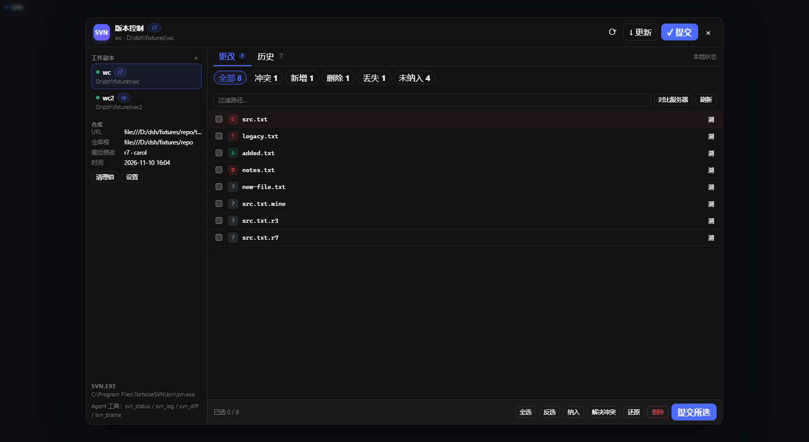
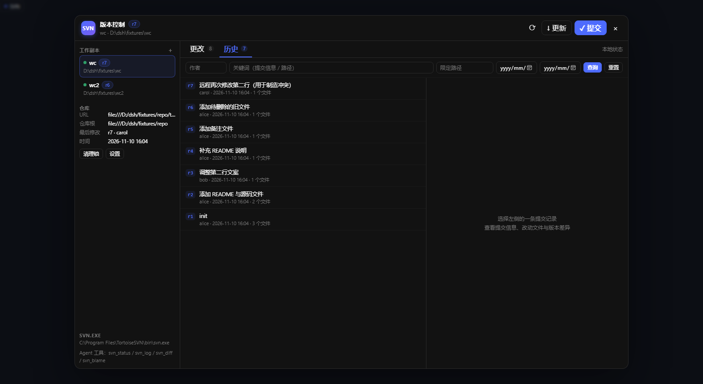
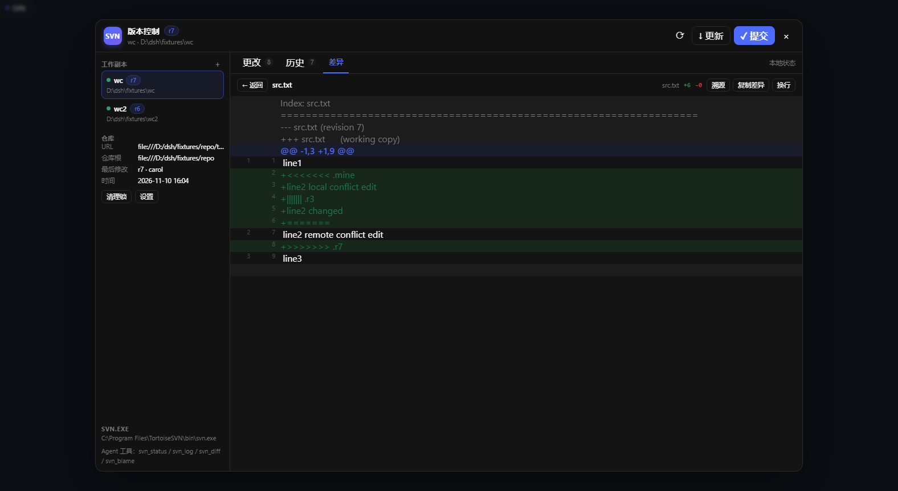
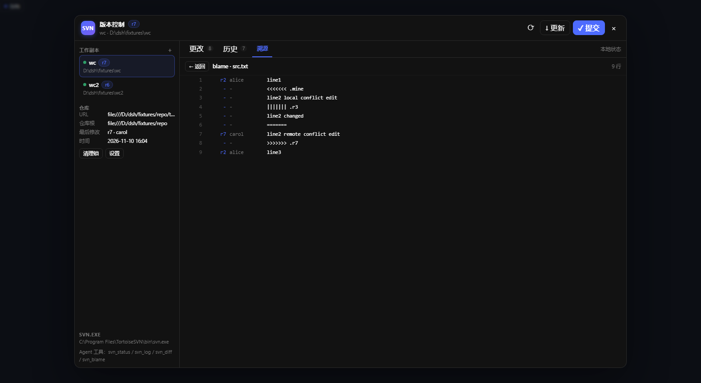
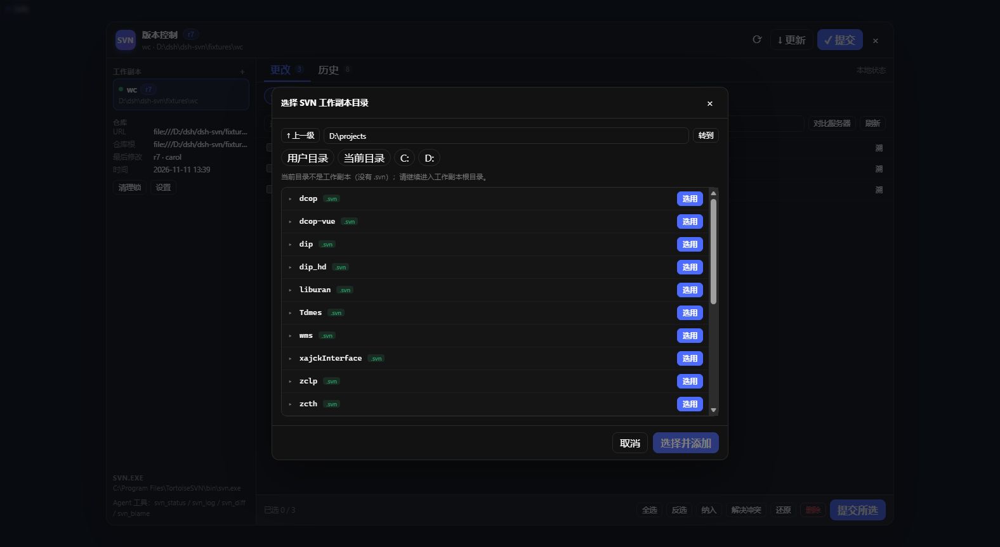
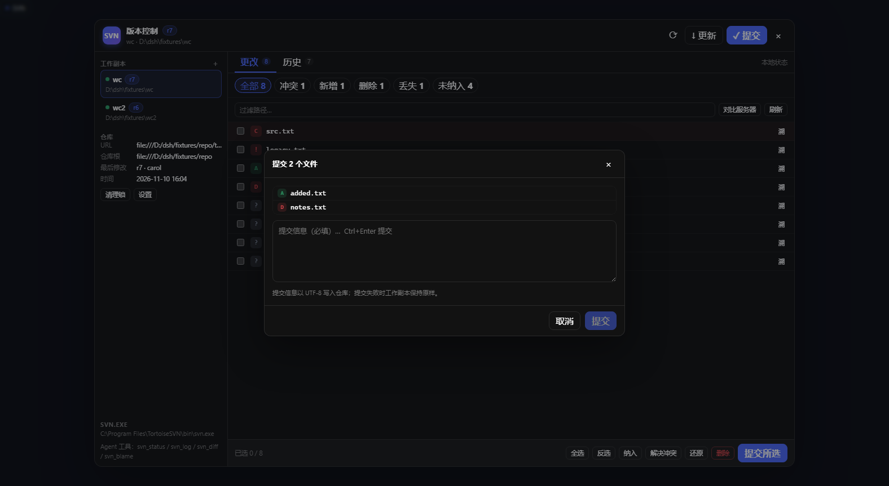

# DSH SVN

`dsh-svn` —— DeepSeek Harness 的 SVN 管理面板，交互参考 TortoiseSVN：看本地更改、翻提交历史、看某个版本改了什么、逐行溯源，也能更新 / 提交 / 还原 / 解决冲突。

> 非 TortoiseSVN 官方项目，也非 DeepSeek 官方项目；「TortoiseSVN 风格」仅指交互参考。TortoiseSVN / DeepSeek 是其各自权利人的商标。

仓库：[GitHub](https://github.com/EastChilde/dsh-svn) · [Gitee](https://gitee.com/EastChilde/dsh-svn)

- 服务端：Cordis 插件 + 宿主 `webServer` 路由 + 5 个只读 Agent 工具
- 浏览器端：`window.__ModuleLoader__` 客户端插件，React + 纯 DOM，无构建步骤
- 已在 DSH `desktop` profile 实测通过



## 功能

**更改（工作副本状态）**

- `M` 修改、`A` 新增、`D` 删除、`!` 丢失、`C` 冲突、`R` 替换、`?` 未纳入、`I` 忽略
- 按状态筛选、按路径过滤、勾选文件
- `对比服务器`（`svn status -u`）查看远端是否有新版本
- 一键：还原、纳入版本控制、删除、标记冲突已解决、提交所选

**历史**

- 版本号、作者、时间、提交信息、改动文件数
- 按作者 / 关键词 / 路径 / 日期区间过滤，分页加载更早提交
- 提交详情：完整提交信息、改动路径清单、复制版本号、查看整版差异
- 点击单个改动路径 → 只看该文件在此版本中的差异；`溯` → 按该版本溯源



**差异查看**

- 标准 unified diff，行号、增/删行高亮、`@@` 段、属性变更
- 换行开关、复制差异、文件统计（+N / -N）
- 未纳入版本控制的文件按「新增」合成 diff
- 二进制文件明确提示



**逐行溯源（blame）**

- 行号、版本、作者、行内容
- 点版本号直接跳到该版本的差异
- 本地有未提交改动时，本地行显示为 `-`



**写操作**

- 更新（`svn update --accept postpone`，冲突会被标记出来）
- 提交（提交信息以 UTF-8 写入，Windows 下不再乱码）
- 还原（`svn revert -R`）、纳入（`svn add`）、删除（`svn delete`）
- 解决冲突（保留工作副本 / 我的版本 / 仓库版本 / BASE）
- 清理（`svn cleanup`）
- 所有危险操作都有确认弹窗；同一工作副本的写操作串行执行

**工作副本管理**

- 首次打开自动扫描：当前目录、用户目录、各盘符（最多 8 个）
- 内置目录浏览器：点「浏览…」逐级选文件夹，`.svn` 目录自动标记，可一键选用
- 也支持手动输入路径、按目录扫描，支持多个工作副本切换
- 侧栏显示仓库 URL、仓库根、最后提交版本 / 作者 / 时间
- 设置里可指定 `svn.exe` 路径、关闭自动发现





## 入口

| 入口 | 位置 |
| --- | --- |
| 会话头部「SVN」按钮 | 对话页顶部工具栏，打开全屏面板 |
| 右侧栏「SVN」标签 | 侧栏概览：状态统计、改动文件、最近提交，可展开 |
| 设置 → SVN 版本控制 | 设置页整页入口 |
| 深链 | `http://127.0.0.1:<DSH 端口>/#svn`（历史页 `#svn/history`） |

## Agent 工具（只读）

模型可以在对话里直接查 SVN，不需要自己拼命令行：

| 工具 | 用途 |
| --- | --- |
| `svn_info` | URL、仓库根、当前版本、最后提交 |
| `svn_status` | 本地更改清单，可选 `remote` 对比服务器 |
| `svn_log` | 提交历史，支持 `path` / `author` / `keyword` / 日期 / 分页 |
| `svn_diff` | 工作副本差异、某版本差异、版本区间差异 |
| `svn_blame` | 逐行溯源，可指定起始行与行数 |

刻意不提供 commit / update / revert 等写操作：提交是人的决定，面板里有确认流程；模型只读，避免误提交整个工作副本。

## 安装

验证环境已安装到 `desktop` profile：

- `%DSH_HOME%\profiles\desktop\node_modules\dsh-svn` → junction 到本目录
- profile `package.json` 的 `dsh.profile.bundles` 已加入 `dsh-svn`，`dependencies` 为 `link:D:/dsh/dsh-svn`

装到其他 profile / 机器：

```bash
dsh plugin --profile desktop add link:D:\path\to\dsh-svn
```

或手动：

1. 把本目录放到任意位置；
2. 在 profile 的 `node_modules` 下建 junction / symlink 指向本目录（或直接复制）；
3. profile `package.json` 的 `dsh.profile.bundles` 追加 `dsh-svn`；
4. 重启 DSH（浏览器端刷新页面即可，服务端代码改动需要重启或 `POST /dsh-svn/reload`）。

卸载：从 bundles 里移除 `dsh-svn`、删掉 `node_modules\dsh-svn`，重启。

## 配置

`%DSH_HOME%\dsh-svn\config.json`：

```json
{
  "version": 1,
  "workingCopies": [{ "path": "D:\\projects\\my-repo", "name": "my-repo", "auto": false }],
  "svnPath": null,
  "autoDiscover": true,
  "seeded": true
}
```

- `svnPath` 为空时自动查找 TortoiseSVN 默认安装位置或 PATH，也可用环境变量 `DSH_SVN_PATH`
- 删除该文件可让插件下次打开时重新自动发现

## Windows 中文路径说明

`svn.exe` 在中文 Windows 上有一个底层限制：它把命令行参数按 UTF-8 解释，而 Windows 进程实际拿到的是 ACP（中文 Windows 常见 936/GBK）字节，于是中文路径参数会被破坏（提交时甚至会在仓库里生成 `????.txt`）。插件做了针对性处理：

- **读**：状态 / 历史 / 差异 / 溯源都可用。文件级 diff 改走「全量 diff + 按路径过滤」；blame、cat、路径历史改走仓库 URL（百分号编码，纯 ASCII）；中文文件的 unified diff 在 JS 里自己算
- **提交**：选中项覆盖全部可提交文件时，改为整体提交工作副本（效果等价、不需要路径参数）；只选一部分中文路径会被拒绝并提示
- **纳入**：选中全部未纳入文件时用 `svn add --force --depth infinity .`；部分选择且含中文路径会被拒绝
- **还原 / 删除**：含中文路径时拒绝执行，避免改错文件；请用 TortoiseSVN
- 提交信息始终走 `-F file --encoding UTF-8`，与路径问题无关

## HTTP 接口

全部为 `POST`，JSON body，挂载在 `/dsh-svn/*`：

| 路径 | 说明 |
| --- | --- |
| `/state` | 配置 + 工作副本列表 + 仓库信息 |
| `/wc/add`、`/wc/remove` | 添加 / 移除工作副本 |
| `/discover` | 扫描目录找 `.svn` |
| `/settings` | svnPath / autoDiscover |
| `/status` | 工作副本状态 |
| `/log` | 提交历史（过滤 / 分页） |
| `/diff` | 工作副本 / 版本 / 区间差异 |
| `/blame`、`/cat`、`/info` | 溯源 / 文件内容 / 仓库信息 |
| `/update`、`/commit`、`/revert` | 更新 / 提交 / 还原 |
| `/add`、`/delete`、`/resolve`、`/cleanup` | 纳入 / 删除 / 解决冲突 / 清理 |
| `/reload` | 热重载服务端 `core.js`（开发用） |

## 开发与测试

```bash
cd dsh-svn
node test/setup-fixture.mjs   # 重建本地 SVN fixture（repo + wc + wc2，含冲突/缺失/未纳入）
node test/smoke.mjs           # 核心逻辑测试（21 项）
node test/http.mjs            # HTTP 接口测试（需宿主在跑；可用 DSH_SVN_BASE 指定地址）
```

如果 `svn.exe` / `svnadmin.exe` 不在 TortoiseSVN 默认安装位置，用 `DSH_SVN_PATH` 指向 `svn.exe`（`svnadmin.exe` 默认取同目录，也可用 `DSH_SVN_ADMIN` 单独指定）。

`test/http.mjs` 默认打 `http://127.0.0.1:61382/dsh-svn`（换成你实际的 DSH 端口）；也可以用环境变量指向任意实例：

```powershell
$env:DSH_SVN_BASE='http://127.0.0.1:61399/dsh-svn'; node test/http.mjs
```

仓库结构：

```
dsh-svn/
  lib/index.js     插件入口：路由注册 + 工具注册 + 热重载
  lib/core.js      业务逻辑：配置、工作副本、查询、写操作、中文路径处理
  lib/svn.js       svn.exe 执行层（无 shell、超时、错误整理）
  lib/xml.js       极简 XML 解析器（只服务 svn --xml）
  lib/tools.js     5 个只读 Agent 工具
  client/client.js 浏览器端：侧栏标签 + 全屏面板 + 弹窗
  test/            fixture、冒烟测试、HTTP 测试
  docs/            截图
```

## 安全

- Agent 工具全部只读
- 不采集、不上传任何数据；SVN 凭据由 `svn.exe` / TortoiseSVN / 系统凭据缓存管理，插件不接触密码
- 所有路径先折算到「已登记工作副本内的相对路径」，拒绝 `..` 与越界
- 命令用参数数组执行，不经过 shell；路径参数尽量少传，中文路径走 URL / 整体操作
- 写操作按工作副本加锁串行；危险操作需要 UI 二次确认
- 超时与输出上限：diff 1.8 MB、cat 512 KB、blame 5000 行

## License

MIT

发布到 GitHub / Gitee 时可直接复制的名称、简介、标签与 Release notes 见 [PUBLISH.md](PUBLISH.md)。
